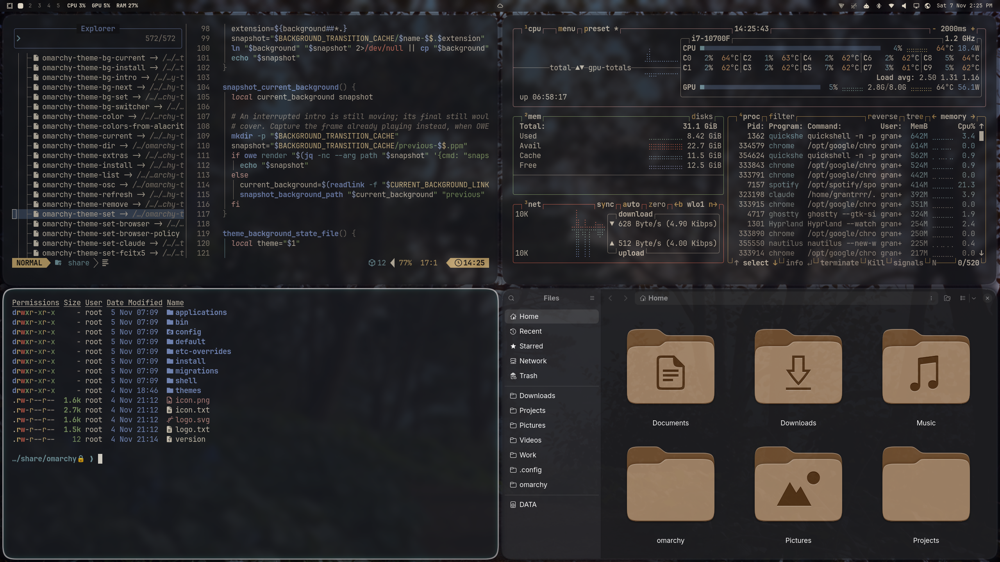

# Reverie

A dark [Omarchy](https://omarchy.org/) theme: slate and gold, frosted glass, and old San Francisco at dusk.



## Install

```bash
omarchy theme install https://github.com/grant018/omarchy-reverie-theme
rm -rf ~/.config/omarchy/themes/reverie/.git
omarchy theme set reverie
```

The second line matters. Omarchy doesn't load Lua from a theme installed from git (any theme folder with a `.git` directory), so without it you get Reverie's colors and wallpapers but not its `hyprland.lua`: no blur, glow, rounding or animations, and the menus are see-through but not frosted. Removing `.git` tells Omarchy the theme is yours. Since `hyprland.lua` is code Hyprland runs, give it a read first.

Without `.git`, `omarchy theme update` won't update Reverie. To update, run the three lines again. Or, to keep it a git checkout, clone it somewhere else and link it in:

```bash
git clone https://github.com/grant018/omarchy-reverie-theme ~/src/omarchy-reverie-theme
ln -s ~/src/omarchy-reverie-theme ~/.config/omarchy/themes/reverie
omarchy theme set reverie
```

Then `git pull` in `~/src/omarchy-reverie-theme` and run `omarchy theme set reverie` again to update.

Built and tested on Omarchy 4.5.

## Your settings win

Anything you've set in `~/.config/hypr/looknfeel.lua` loads after the theme and overrides it. If you've changed gaps, borders, rounding, blur or opacity there, comment those lines out to see Reverie as intended. The same goes for Omarchy's look toggles, such as Corners Sharp, Window Opaque and No Animations.

## What's in it

- **Four wallpapers**, 4K: a cypress grove, a gallery, a hillside view of the city, and a garden. Cycle through them with `omarchy theme bg next`.
- **Frosted glass**: translucent windows, menu, launcher and bar panels, blurred over the wallpaper. The blur matches Omarchy's Glassy bar, so it looks the same with that toggle on or off.
- **Silver frames**: a silver gradient on the focused window, the menu, the launcher and the bar panels, with gold highlights.
- **Soft motion**: springy window and scratchpad animations, and a border shimmer when a window gains focus.
- Rounded corners, soft shadows and a faint glow, plus a matching btop theme and Yaru Warty Brown icons.

## License

The theme's configuration files are [MIT licensed](LICENSE). The license doesn't cover the wallpapers or the preview image.
